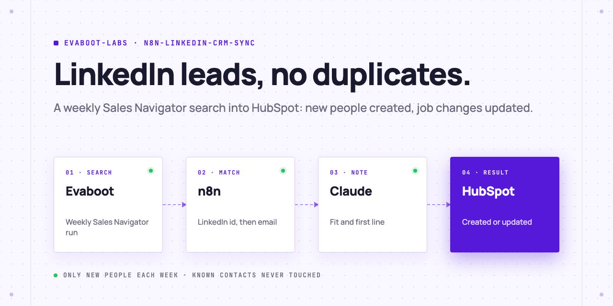
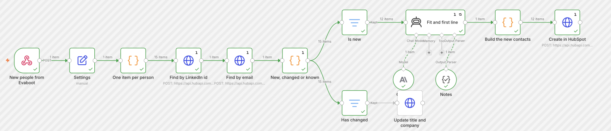

<picture>
  <source media="(prefers-color-scheme: dark)" srcset=".github/assets/banner-dark.png">
  
</picture>

# LinkedIn to HubSpot sync

Every week, Evaboot runs your Sales Navigator search and sends the new people to n8n. The workflow matches each one to HubSpot by LinkedIn id and email, creates the new people who fit with a one-line opener written by Claude, updates the ones who changed jobs, and leaves everyone else alone.

[](AGENTS.md)
[](https://evaboot.com/mcp)
[](LICENSE)

## Set it up in one prompt

Paste this into Claude Code, Codex or Cursor:

```text
Clone https://github.com/evaboot-labs/n8n-linkedin-crm-sync, read AGENTS.md and follow the skill. Set up the weekly LinkedIn to HubSpot sync in my n8n.
```

<details>
<summary>Or install the skill</summary>

Claude Code:

```text
/plugin marketplace add evaboot-labs/n8n-linkedin-crm-sync
/plugin install n8n-linkedin-crm-sync@evaboot-labs-n8n-linkedin-crm-sync
```

Codex, Cursor and other agents:

```bash
npx skills add evaboot-labs/n8n-linkedin-crm-sync
```

</details>

## How it works

**1. A Sales Navigator search, every week.** Evaboot exports it with verified emails and sends each run to the n8n webhook. Each run holds only the people new to the search.

**2. Every person is matched to HubSpot.** By LinkedIn id first, because it never changes, then by email. Each person is new, changed (another title or company) or known.

**3. New people get a first line.** Claude writes a fit and one opener per new person, from their title, headline and company description. The ones who fit are created; known people are not touched.

**4. Job changes update the CRM.** A changed person gets the new title and company, and `linkedin_change` keeps what they were.

```text
$ python3 sync.py match queue/leads.json > queue/matched.json
15 people: 12 new, 0 changed, 3 already in HubSpot
```



**5. Or run it from your AI Agent.** `sync.py` does the same match, check, review and write from Claude Code, Codex or Cursor, with you reading every change first.

## What you need

- An [Evaboot account](https://dash.evaboot.com/accounts/signup/?last_click_origin=n8n-linkedin-crm-sync-repo) and a Sales Navigator seat.
- n8n (cloud or self-hosted), a HubSpot private app or service key, and an Anthropic key.
- Cost: 1 Evaboot credit per exported lead. A push of a finished export to n8n is free.

## Go further

| Page | For |
|---|---|
| [docs/n8n.md](docs/n8n.md) | The workflow, the two HubSpot properties and the weekly export |
| [docs/connect-your-agent.md](docs/connect-your-agent.md) | The keys and the agent setup |
| [BUYERS.md](BUYERS.md) | Who fits, and the first-line rules |

---

Agents: start at [AGENTS.md](AGENTS.md) · Built by [Evaboot](https://evaboot.com) · More workflows at [github.com/evaboot-labs](https://github.com/evaboot-labs) · [MIT license](LICENSE)
